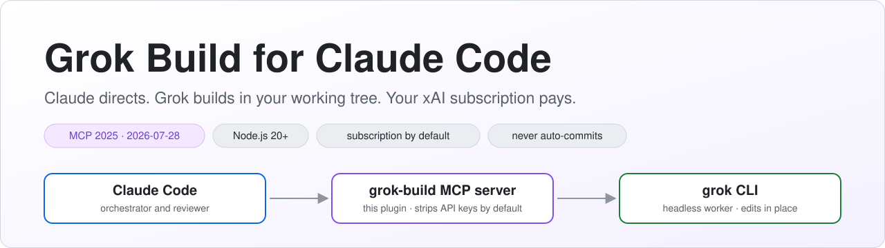
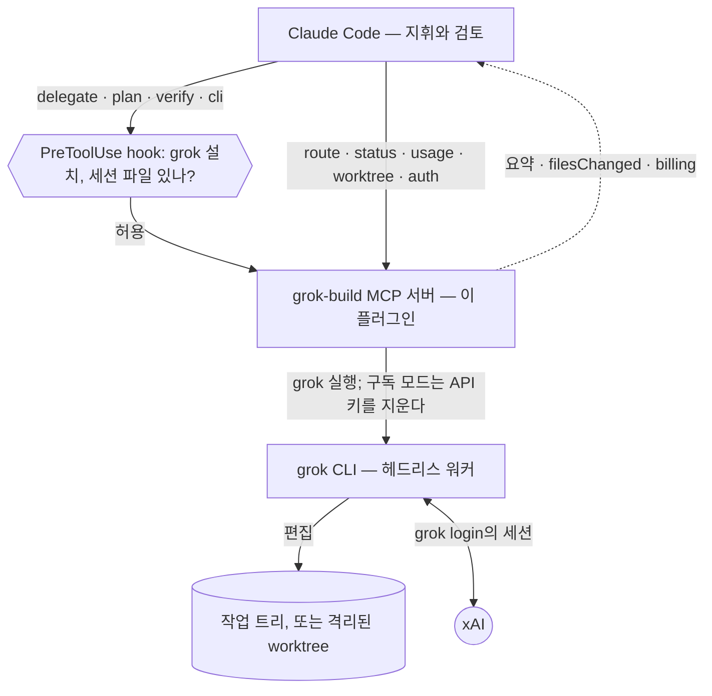
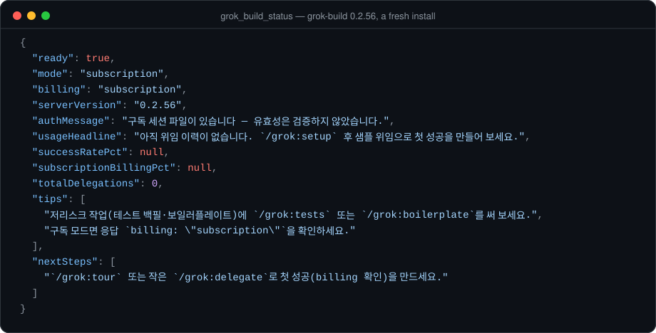
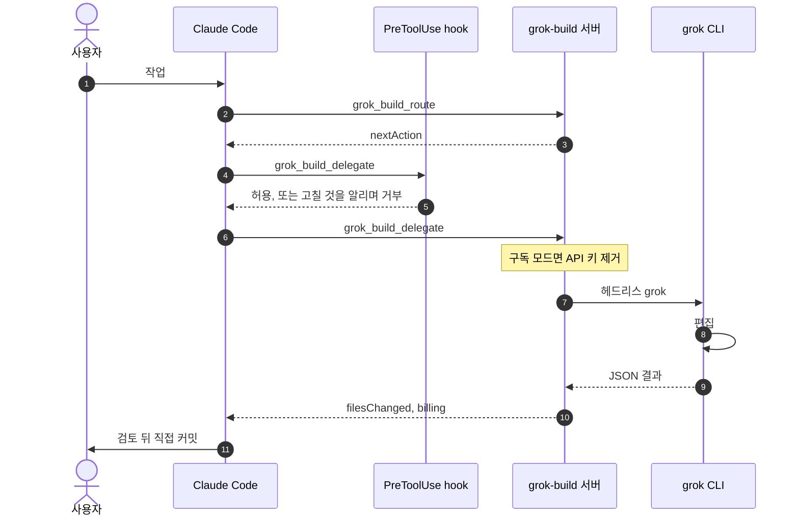

<h1 align="center">
  <picture>
    <source media="(prefers-color-scheme: dark)" srcset="docs/images/hero-dark.svg">
    
  </picture>
</h1>

<p align="center">
  <a href="README.md">English</a> · <b>한국어</b>
</p>

<p align="center">
  <a href="https://github.com/xzawed/claude-grok-build-plugin/actions/workflows/ci.yml"></a>
  <a href="LICENSE"></a>
  
  
  
</p>

> Claude가 코딩 작업 일부를 **[Grok Build](https://x.ai/cli)** CLI에 넘길 수 있게 하는
> **Claude Code 플러그인**. 과금은 모르는 사이에 종량제 API로 새지 않고 **xAI 구독**으로
> 갑니다.
>
> Claude가 지휘하고 Grok이 작업 트리에서 실행하며, 품질 게이트는 사용자가 쥡니다 — 대신
> 커밋해 주는 일은 없습니다.

**목표:** Grok을 잘 쓰게 · Grok이 강한 지점을 확인 · Claude ↔ Grok 협업 —
[`docs/00-product-vision.md`](docs/00-product-vision.md). 사람이 읽는 시작 지도는
[`docs/08-getting-started-with-grok.md`](docs/08-getting-started-with-grok.md)입니다. 설치 후
**`/grok:tour`** 를 돌리세요 — 15분 가이드로 첫 성공까지, 과금 확인 포함입니다.

**목차:** [무엇을 하나](#무엇을-하나) · [빠른 시작](#빠른-시작) · [언제 위임하나](#언제-위임하고-언제-하지-않나) ·
[커맨드](#커맨드) · [MCP 도구](#mcp-도구) · [위임이 도는 순서](#위임이-도는-순서) ·
[과금·승인 안전](#과금승인-안전) · [프로토콜 지원](#프로토콜-지원) · [설치·과금 검증](#설치과금-검증) · [문제 해결](#문제-해결) ·
[문서](#문서)

## 무엇을 하나



- **어떻게가 아니라 언제 위임할지.** Claude 쪽 라우팅(`/grok:route`와 `grok-routing` 스킬)이
  대량·저리스크 작업에는 Grok을 제안하고, 아키텍처와 보안은 Claude에 남깁니다.
- **볼륨 작업을 격리.** 위임을 전용 git worktree에서 돌릴 수 있어, 마이그레이션·테스트
  백필·보일러플레이트가 사용자가 적용하기 전까지 체크아웃을 건드리지 않습니다. Grok Build는
  실행 중 스스로 subagent도 띄웁니다.
- **종량제가 아닌 구독.** 서버는 기본값으로 `grok`을 spawn하기 전에 `XAI_API_KEY` /
  `GROK_CODE_XAI_API_KEY`를 제거하므로, 위임 작업이 종량제 API 요율이 아니라 SuperGrok /
  X Premium+ 플랜 안에서 실행됩니다.
- **컨벤션 자동 승계.** 기존 `CLAUDE.md` / `AGENTS.md`와 `.claude/` 설정(skill·agent·MCP·hook)을
  추가 설정 없이 그대로 읽습니다.

MCP 서버와 hook은 `mcp-server/dist/`에 빌드된 번들로 배포되므로, 설치 후 따로 빌드할 필요가
없습니다.

## 빠른 시작

### 요구 사항

| 요구 사항 | 필요한 것 | 확인 |
|---|---|---|
| Claude Code | 플러그인을 지원하는 릴리스 — 2.1.332로 실측 | `claude --version` |
| Grok Build CLI | PATH에서 찾히는 `grok` — 1.0.92로 실측(스스로 업데이트됩니다) | `grok --version` |
| Node.js | PATH에서 찾히는 `node`가 **20 이상** — 플러그인의 MCP 서버가 그것으로 돕니다 | `node --version` |
| xAI 플랜 | 활성 **SuperGrok / X Premium+** 구독 — 또는 [종량제 API 모드](#인증-모드)용 xAI API 키 | 2단계 스모크 테스트 |

> [!NOTE]
> Node 18에서는 MCP 서버가 찾은 버전을 밝히는 한 줄을 남기고 시작하지 않고, 그보다 오래된 Node는 그 전에 문법
> 오류로 멈출 수 있습니다(Node 16.0이 그렇습니다). 어느 쪽이든 grok 도구가 보이지 않습니다.

1~2단계는 터미널에서 최초 1회만 하고, OS마다 다른 건 설치 명령뿐입니다. 3단계는 Claude Code
안에서 실행하며 모든 환경에서 동일합니다.

### 1. Grok Build CLI 설치 (최초 1회)

- **macOS / Linux** — 아무 셸(bash, zsh 등):
  ```bash
  curl -fsSL https://x.ai/cli/install.sh | bash
  ```
- **Windows — PowerShell** (예: Windows Terminal 탭):
  ```powershell
  irm https://x.ai/cli/install.ps1 | iex
  ```
- **Windows — WSL** (Ubuntu 등): 위 macOS/Linux 명령을 WSL 셸 *안에서* 실행합니다.

> [!IMPORTANT]
> Windows 명령 프롬프트(`cmd.exe`)는 두 설치기 모두 지원하지 않습니다 — PowerShell이나 WSL을
> 쓰세요. 그리고 한쪽을 정했으면 Claude Code도 같은 쪽에서 실행하세요. WSL 설치본은 네이티브
> Windows에서 보이지 않고, 그 반대도 마찬가지입니다.

### 2. 로그인 + 스모크 테스트 (브라우저 OAuth, 최초 1회)

```bash
grok login
grok --no-auto-update -p "Say ok."
```

플러그인이 대신 로그인하거나 키를 저장하는 일은 없습니다.

### 3. 플러그인 설치 — Claude Code 안에서

아래는 **터미널 명령이 아니라 Claude Code 프롬프트**이며, 모든 OS에서 동일합니다:

```
/plugin marketplace add xzawed/claude-grok-build-plugin
/plugin install grok@grok-marketplace
/reload-plugins
/grok:setup
```

`/grok:setup`이 준비 상태를 확인해 줍니다. 이어서 **`/grok:tour`** 가 인증 → 라우트 데모 →
작은 첫 성공 → 다음에 해볼 것까지 안내합니다.

### 새로 설치하면 보이는 것

`/grok:status`는 `grok_build_status` 도구를 읽습니다. 아래는 그 도구를 v0.2.56 번들로, 세션 파일 자리에 빈 `{}`만
두고 위임 이력은 없는 새 홈에서 부른 실제 결과이며 손대지 않았습니다 — `ready`, `mode`와 그것이 함의하는 `billing`,
실행 중인 `serverVersion`, 처음 해 볼 것. 도구는 세션 파일이 있는지만 보고 내용은 읽지 않으므로 실제 `grok login`
뒤에도 같습니다 — `ready: true`는 파일이 있다는 뜻이지 세션이 유효하다는 뜻이 아닙니다. 그림은
[`mcp-server/scripts/status-figure.mjs`](mcp-server/scripts/status-figure.mjs)가 그리고, 테스트가 지금 번들의 답과
대조합니다.

<p align="center">
  
</p>

### 업데이트

설치는 최초 1회지만 업데이트는 3단계이고 **순서가 중요합니다.** 앞의 둘은 Claude Code
프롬프트가 아니라 터미널 명령입니다:

```bash
claude plugin marketplace update grok-marketplace   # 1. 로컬 마켓플레이스 클론 갱신
claude plugin update grok@grok-marketplace          # 2. 새 버전 설치
```

그다음 **Claude Code를 재시작하고** `/grok:status`를 다시 확인하세요 — `serverVersion`이 새
버전이어야 합니다.

1번은 건너뛸 수 없습니다. `/plugin marketplace add`가 남긴 로컬 클론은 `autoUpdate: false`로
등록되므로, 클론이 낡아 있는 동안에는 2번이 설치할 새 버전을 보지도 못합니다(2026-09-04 실측).
그리고 `claude plugin update`는 재시작해야 반영됩니다 — 재시작 전까지 세션은 시작할 때 띄운
MCP 서버 프로세스를 그대로 물고 있습니다.

> [!NOTE]
> `/grok:update`는 다른 커맨드입니다 — 이 플러그인이 아니라 **grok CLI를 업데이트합니다.**

## 언제 위임하고, 언제 하지 않나

| Grok에 넘길 일 | Claude가 쥘 일 |
|---|---|
| 대량 반복 편집 — 같은 패턴을 여러 파일에, 이름 변경, import 정리 | 아키텍처·설계 판단 |
| 저리스크 볼륨 — 테스트 백필, 문서 동기화, 보일러플레이트 | 보안·규제 — 인증·권한·암호화, 의료·금융 등 규제 도메인 |
| 좁고 독립적인 범위 — 단일 모듈, 명확한 수용 기준 | 모노레포 전체 맥락이 필요한 작업 |
| 어차피 검토할 탐색적 프로토타입 | 최종 리뷰와 품질 게이트 |

`/grok:route` 가 이 기준을 대신 적용해 `nextAction`을 돌려줍니다 — 실행도 과금도 하지
않습니다. 전체 기준은 [`docs/05-routing-policy.md`](docs/05-routing-policy.md).

## 커맨드

플러그인은 `/grok:*` 커맨드 27개를 배포합니다 — 접두어는 Claude Code가 플러그인명 `grok`에서
도출합니다. 아래 15개가 평소에 직접 치는 것들이고, 나머지 12개는 grok 자체 CLI를 감싼 것으로
표 아래에 접어 두었습니다.

**매일 쓰는 흐름**

| 커맨드 | 하는 일 |
|---|---|
| `/grok:route` | Claude vs Grok 추천 + **`nextAction`** (실행·과금 없음) |
| `/grok:plan "<작업>"` | 계획 미리보기 — 파일은 읽고, 셸·편집·MCP 도구는 사용자의 허용 규칙이 승인한 것까지 거부됩니다. 지키는 것은 grok이라 `planWroteFiles`는 여전히 확인하세요 |
| `/grok:delegate "<작업>"` | 작업 위임 — grok이 `cwd`에서 직접 편집, 자동 커밋 없음 |
| `/grok:verify "<작업>"` | 위임 + grok 자기검증 (프롬프트 체크리스트) |
| `/grok:review` | 위임 후 품질 게이트 (diff + billing; 자동 커밋 없음) |
| `/grok:worktree` | 격리 worktree list/diff/apply/remove/prune (자동 커밋 없음) |
| `/grok:resume` | 이전 Grok 세션 이어가기 (`lastSession.sessionId`) |
| `/grok:usage` | 사용량 요약 + insights(성공률·구독 비중) |

**설치·프리셋·패스스루**

| 커맨드 | 하는 일 |
|---|---|
| `/grok:setup` | grok 설치 + 로그인 확인; 첫 성공 샘플 + 다음 시나리오 |
| `/grok:status` | **대시보드** — 준비됨?, billing, 사용량, last session, next steps |
| `/grok:tour` | **15분 가이드 투어** — 인증, 라우트 데모, 작은 첫 성공, 다음 레시피 |
| `/grok:tests` | 프리셋: 테스트 백필/확장 |
| `/grok:migrate` | 프리셋: 다파일 기계적 마이그레이션 |
| `/grok:boilerplate` | 프리셋: 스캐폴드/보일러플레이트 |
| `/grok:cli "<raw grok args>"` | 패스스루: 임의 grok 서브커맨드를 빌링 안전 env로 실행 |

<details>
<summary><b>나머지 12개 — grok 자체 CLI 동사</b></summary>

| 커맨드 | 하는 일 |
|---|---|
| `/grok:sessions` | Grok 세션 목록·검색·삭제 (복원은 없음 — `/grok:resume` 사용) |
| `/grok:export` | Grok 세션 트랜스크립트를 Markdown으로 내보내기 |
| `/grok:memory` | Grok 세션 간 메모리 관리 |
| `/grok:inspect` | 이 디렉토리에서 Grok이 발견하는 설정 보기 |
| `/grok:models` | 사용 가능한 Grok 모델 목록 |
| `/grok:mcp` | Grok의 MCP 서버 설정 관리 |
| `/grok:login` | 최초 1회 터미널 로그인 안내 (대신 실행하지는 않음) |
| `/grok:logout` | 로그아웃 및 캐시된 자격증명 삭제 |
| `/grok:update` | Grok 업데이트 확인 또는 설치 |
| `/grok:version` | 설치된 Grok 버전 표시 |
| `/grok:trace` | Grok 세션 트레이스 데이터 내보내기·업로드 |
| `/grok:import` | `blocked`을 반환 — Grok CLI 1.0 서브커맨드가 아닙니다. `/grok:sessions` + `/grok:resume`을 쓰세요 |

이 그룹에서 알아둘 것 두 가지:

- `/grok:worktree`는 여기 **없습니다.** `grok_build_worktree` tool 기반이며, grok 자체
  `worktree` 서브커맨드와는 다른 트래커입니다.
- `/grok:login`과 `/grok:import`는 grok을 아예 띄우지 않습니다. 앞은 터미널에서 칠 명령을
  안내하고, 뒤는 `blocked`을 돌려줍니다. 같은 가드가 grok의 비-헤드리스 모드
  (`dashboard`·`agent`·`leader`·`completions`·`wrap`·`worker`/`cursor-worker`·`workspace`)도
  막습니다 — 헤드리스 호출을 멈춘 채 기다리게 하거나(TUI·서버) 계정에 작용(`worker`·`workspace`)하기 때문입니다.
</details>

**스킬·에이전트 (자동 발견):**

- `grok-routing` — 대량·저리스크에서 Grok 제안, 설계·보안은 Claude
- `grok-first-mile` — 온보딩 / "뭘 먼저 해보지?"
- `grok-worker` agent — 볼륨 작업을 MCP로 실행, Claude가 리뷰

## MCP 도구

커맨드는 `mcp-server/`(TypeScript, ESM)가 stdio로 제공하는 MCP 도구 9개를 부르고, 여기에 PreToolUse
인증(auth-check) hook이 더해집니다. 그중 넷이 grok CLI를 실행하고, hook은 그 넷을 막아 섭니다. 요청·응답
스키마는 [`docs/04-mcp-server-spec.md`](docs/04-mcp-server-spec.md).

| 도구 | 하는 일 | grok 실행 |
|---|---|---|
| `grok_auth_check` | grok이 설치돼 있는지, 세션 파일(또는 API 키)이 있는지 — 있는지만 보고 내용은 읽지 않습니다 | 아니요 |
| `grok_build_status` | `/grok:status`가 읽는 대시보드: 인증, `mode`와 `billing`, 사용량, 마지막 세션, 다음 단계, 있으면 `billingCaveat` | 아니요 |
| `grok_build_route` | 작업에 Claude와 Grok 중 무엇이 맞는지 추천하고 `nextAction`을 돌려줍니다 | 아니요 |
| `grok_build_delegate` | 작업을 grok에 넘깁니다 — `cwd`나 격리된 git worktree에서; `filesChanged`·`billing`·`committed`를 알립니다 | 예 |
| `grok_build_plan` | 계획 미리보기: grok에게 셸·편집·쓰기·MCP 도구를 거부하고, 그래도 썼는지는 `planWroteFiles`가 알립니다 | 예 |
| `grok_build_verify` | 프롬프트에 자기검증 체크리스트를 넣어 위임합니다 | 예 |
| `grok_build_usage` | `~/.grok-build/history.jsonl`의 위임 이력과 성공률·구독 비중 | 아니요 |
| `grok_build_worktree` | 저장소의 worktree를 나열하고, 래퍼가 만든 격리 worktree를 diff·apply·remove·prune합니다. 커밋은 하지 않습니다 | 아니요 |
| `grok_cli` | 임의 grok 서브커맨드를 빌링 안전 env로 실행합니다; 헤드리스로 못 돌거나 계정에 작용하는 것은 거절합니다 | 예 |

## 위임이 도는 순서



라우팅(2단계, `grok_build_route`)은 실행도 과금도 하지 않습니다. hook(4–5)은 grok이 설치돼 있지 않을 때, 그리고 구독
모드에서 세션 파일이 없을 때 고칠 것을 알리며 호출을 막고, 아니면 통과시킵니다. 파일이 있는지만 볼 뿐 세션이 유효한지는
보지 않으며, `grok_cli`는 턴을 실행할 수 있는 호출만 세션이 필요합니다. 구독 모드의 서버는 `XAI_API_KEY`와
`GROK_CODE_XAI_API_KEY`를 지운 뒤 grok을 헤드리스로 실행합니다(7) — `--no-auto-update`, `--always-approve`,
`--cwd <폴더>`, 프롬프트는 `--single=<프롬프트>`(명령줄에 너무 길면 `--prompt-file`), `--output-format json`; plan
실행은 `--always-approve` 대신 `--permission-mode plan`과 거부 규칙을 넘깁니다. grok은 `cwd`나 git worktree에서
편집합니다(8). 위임이면
서버는 grok의 원출력이 아니라 구조화된 요약 — `status`·`filesChanged`·`billing`·`committed` — 을 Claude에 넘기고(10),
사용자는 `/grok:review`로 diff를 검토한 뒤 직접 커밋합니다(11). 전체 아키텍처:
[`docs/01-architecture.md`](docs/01-architecture.md).

## 과금·승인 안전

> [!CAUTION]
> **기본값인 구독 모드**에서는 서버가 `grok`을 spawn하기 전에 `XAI_API_KEY`와
> `GROK_CODE_XAI_API_KEY`를 제거하므로, 이 두 변수는 위임의 자격증명이 될 수 없습니다.
> (grok 자체 `config.toml`의 모델은 여전히 자기 키를 가질 수 있습니다. `api_key`로 적거나,
> `env_key`로 그 두 변수가 아닌 다른 변수를 가리키면 됩니다. `model_provider`로 `[model_providers.<id>]` 표의 키를
> 물려받을 수도 있습니다. 그 키는 제거가 닿지 않으므로 플러그인이 대신
> `billingCaveat`로 알립니다 — 문제 해결 참고.) 이는 프로세스에 **무엇을 넘기느냐**에 대한 보장이지, CLI가 어느 쪽을 고를
> 것인가에 대한 주장이 아닙니다 — grok 1.0.13 실측 기준 유효한 세션 토큰이 이기고 env 키는
> 시도조차 되지 않습니다. env 키는 **세션이 없거나 만료된 순간** 폴백이 되며, 바로 그때
> "구독"으로 시작한 실행이 조용히 종량제로 청구될 수 있습니다. 키를 지우면 그 실행은 조용히
> 과금되는 대신 명시적으로 실패합니다. 상세:
> [`docs/specs/grok-cli-contract.md`](docs/specs/grok-cli-contract.md) §10.

- 모든 `grok_build_delegate` 응답은 설정된 `mode`와 그 모드가 함의하는 `billing`을 밝힙니다 —
  `GROK_BUILD_AUTH_MODE`에서 파생된 표기이며 xAI가 실제로 청구한 값의 관측치가
  아닙니다(`docs/specs/grok-cli-contract.md` §2).
- 서버는 자격증명을 저장·로깅하지 않습니다. 세션 파일과 키는 읽지 않고 존재 여부만 확인합니다.
  grok의 `config.toml`은 자체 키를 가졌거나 `[model_providers.<id>]`에서 키를 물려받는 모델이 있는지
  보려고만 읽고, 키 문자열은 그 자리에서 버립니다(`billingCaveat`).
- **위임은 로컬에 기록됩니다.** 매 위임마다 `~/.grok-build/history.jsonl`에 한 줄이 추가되며,
  **프롬프트 앞 ~200자**·작업 디렉토리·변경 파일이 담깁니다. `/grok:usage`·`/grok:status`가
  이를 다시 읽으므로 그 미리보기는 이후 Claude 세션으로 되돌아옵니다. 알려진 시크릿 형태는
  기록 전에 마스킹하지만 **패턴 매칭은 완화이지 보장이 아닙니다** — 로그에 남기고 싶지 않은
  것은 프롬프트에도 넣지 마세요. 지우려면 파일을 삭제하면 되고, 다른 기능은 여기 의존하지
  않습니다.

> [!WARNING]
> **모든 위임은 grok의 tool 사용 전체를 자동 승인합니다** — 파일 편집뿐 아니라 셸 명령·삭제·
> 설치·네트워크·git까지이며, 파일이 아닌 부작용은 `filesChanged` diff에 드러나지 않습니다.
> 헤드리스 `grok`은 `--always-approve` 없이는 편집을 믿고 맡길 수 없으므로(없으면 사용자 허용 규칙·grok의
> `[ui] permission_mode`가 승인하지 않은 호출은 `stopReason: "cancelled"`로 취소됩니다) 플러그인이 항상 이
> 플래그를 붙입니다.
>
> `grok`은 대상 `cwd`에서 직접 편집하고, 플러그인은 **커밋하지 않습니다**(grok에게도 하지 말라고 하고,
> grok이 커밋하면 `committed`로 알립니다) — 사람이 먼저 검토합니다.
> 위험한 작업은 grok 플래그가 아니라 **tool 필드로** 격리하세요 — `worktree: true`(래퍼가 진짜
> `git worktree`를 만듭니다. grok 자신의 `--worktree`는 헤드리스 `-p`에서 no-op이고 래퍼는
> 넘기지도 않습니다)와 `sandbox: "workspace" | "strict" | …`이며, 둘 다 `/grok:delegate`로
> 지정합니다. `sandbox`의 커널 강제는 Linux/macOS만입니다.

전체 근거와 검증 체크리스트: [`docs/02-auth-strategy.md`](docs/02-auth-strategy.md).

### 인증 모드

**서버 레벨에서 한 번만** `GROK_BUILD_AUTH_MODE`로 결정합니다 — 호출별 오버라이드는 없습니다.

| | `subscription` (기본) | `api` (opt-in) |
|---|---|---|
| 트리거 | 미설정 또는 `=subscription` | `GROK_BUILD_AUTH_MODE=api` |
| env 처리 | spawn 전 API 키 **제거** | 키 **그대로 통과** |
| 인증 근거 | `~/.grok/auth.json` (`grok login`) | 환경에 있는 API 키 |
| 과금 | xAI 구독 정액 | API 종량제 |
| 응답 `billing` | `"subscription"` | `"metered_api"` |

`GROK_BUILD_AUTH_MODE`를 설정하지 않으면 모든 위임이 구독 모드로 실행됩니다.

<details>
<summary><b>API 모드 설정 (opt-in, 종량제)</b></summary>

모드는 MCP 서버를 띄우는 환경의 `GROK_BUILD_AUTH_MODE`로 읽힙니다. 두 가지 동등한 방법:

- **프로세스 env (권장)** — Claude Code를 시작하는 환경에 설정하면 플러그인 업데이트가 덮어쓰지
  못합니다:
  ```bash
  export XAI_API_KEY="..."          # 본인 소유 키 — 플러그인이 발급/저장하지 않음
  export GROK_BUILD_AUTH_MODE=api
  ```
- **`.mcp.json` env 블록** — `grok-build` 항목에 `env` 추가(플러그인 업데이트 시 덮어쓰일 수
  있음):
  ```json
  "grok-build": {
    "command": "node",
    "args": ["${CLAUDE_PLUGIN_ROOT}/mcp-server/dist/index.js"],
    "env": { "GROK_BUILD_AUTH_MODE": "api" }
  }
  ```
</details>

## 프로토콜 지원

서버는 stdio에서 MCP 프로토콜의 어느 계열에도 답하고, 연결마다 여는 교환이 그중 하나를 정합니다. 두 계열 모두 같은
도구 9개와 입력 스키마, 결과 모양, capabilities를 보입니다. SDK v1 번들(v0.2.55와 그 이전)과 달라진 것은
[`docs/04-mcp-server-spec.md`](docs/04-mcp-server-spec.md)의 "두 프로토콜 계열"에 있습니다.

| 프로토콜 계열 | 세션을 여는 법 | 받는 수정판 | 이렇게 붙는 쪽 |
|---|---|---|---|
| 2025 | `initialize` 다음 `notifications/initialized` | `2025-11-25` · `2025-06-18` · `2025-03-26` · `2024-11-05` · `2024-10-07` | 2025 명세로 만든 클라이언트 |
| 2026-07-28 | `server/discover`; 그 뒤 모든 요청이 `params._meta`를 싣습니다 | `2026-07-28` | Claude Code 2.1.332 (실측: 이 플러그인에 이 계열로 붙습니다) |

2026-07-28 계열을 받는 SDK(MCP SDK v2)가 Node.js 20을 요구하므로, v0.2.56에서 하한이 그리로 올랐습니다.

## 설치·과금 검증

Claude Code 안에서, 설치 + 최초 1회 `grok login` 후:

1. **`/grok:status`** (또는 `/grok:setup`) → `ready`, `mode`, 기대 `billing`, `serverVersion`.
2. 편집돼도 괜찮은 임시 디렉토리에서
   **`/grok:delegate "create a file hello.txt containing exactly: ok"`** — grok이 거기서 실제로
   편집합니다 → `filesChanged`에 `hello.txt`가 있는지 확인하고, 무엇보다
   **`billing`이 `"subscription"`인지**(`metered_api`가 아닌지) 확인하세요.
   - 커밋된 것은 없습니다. **`/grok:review`** 로 diff를 검토하세요.
3. **`/grok:plan "add input validation to the main function"`** → 계획 요약. `planWroteFiles`가 `false`인지 확인하세요
   (plan 실행이 읽기 전용이라는 보장은 없습니다).
4. **`/grok:route`** → `nextAction` 추천; **`/grok:usage`** → 이력과 함께
   **`/grok:resume`** 이 이어갈 `lastSession`.

## 문제 해결

| 증상 | 뜻 | 조치 |
|---|---|---|
| Claude Code에 grok 도구가 보이지 않아 `/grok:setup`이 부르지 못함 | 플러그인의 MCP 서버가 뜨지 않은 것입니다. 대개 PATH의 `node`가 Node.js 20보다 낮습니다. 아니면 `GROK_BUILD_AUTH_MODE`가 `subscription`도 `api`도 아니어서 서버가 그 값을 밝히는 한 줄을 남기고 멈춘 것입니다 | `node --version`으로 확인해 Node.js를 올리거나, 그 변수를 고치거나 지운 뒤 Claude Code를 재시작 |
| `/reload-plugins` 후에도 `/grok:setup`이 안 잡힘 | `/grok:*` 호출 문자열과 마켓플레이스 스키마는 Claude Code 버전에 따라 고정이 아닙니다 | `/help`로 실제 형식을 확인한 뒤 [`docs/03-plugin-spec.md`](docs/03-plugin-spec.md) 참고 |
| `/grok:delegate`가 실행 전에 차단되고 `grok login` 안내가 나옴 | 로그인이 안 된 상태입니다. PreToolUse hook과 서버 자체 인증 확인이 이중으로 막으며, 기본값(env 미설정)에서는 hook이 먼저 막습니다 | 터미널에서 `grok login` 후 다시 시도 |
| `/grok:status`에 상대 경로 `GROK_HOME`에 대한 **`grokHomeNote`** 가 보이거나, 로그인했는데도 위임이 로그인하라고 함 | `GROK_HOME`이 상대 경로입니다(Windows에서는 `\grok`처럼 드라이브 문자 없이 루트부터 쓴 경로도). grok은 그것을 자신이 실행되는 폴더 — 작업 폴더, `worktree: true`면 새로 만든 worktree — 기준으로 풀고 `~`도 풀지 않습니다(Windows 실측). 그래서 폴더마다 grok 홈이 따로 있고, 다른 폴더에서 한 `grok login`은 다른 홈에 들어갔을 수 있습니다 | `GROK_HOME`을 절대 경로로 설정하고 Claude Code를 재시작하세요 — Windows에서는 `C:\…`처럼 드라이브 문자부터 적으세요(드라이브 없는 `\grok`은 grok이 실행되는 폴더의 드라이브에 둡니다). 폴더마다 다른 홈을 원한다면 작업 폴더에서 `grok login`을 실행하세요. `worktree: true`에서는 새 worktree 안의 홈에 세션이 있을 수 없으니, worktree 위임에는 절대 경로 `GROK_HOME`을 쓰세요 |
| **`grokHomeNote`** 가 `GROK_HOME` 앞이나 끝의 공백을 말함 | 값에 스페이스·탭·줄바꿈이 들어 있습니다. 흔한 원인은 cmd입니다 — `set GROK_HOME=C:\x && claude`는 `&&` 앞의 공백까지 값에 넣습니다. grok은 그 문자까지 경로로 씁니다: 끝 공백이면 로그인한 폴더가 아니라 이름이 공백으로 끝나는 폴더에서 세션을 찾고, 끝의 탭·줄바꿈이나 드라이브 문자 앞의 공백이면 경로가 잘못돼 grok이 아예 실패합니다 | 공백을 지우고(cmd에서는 `set "GROK_HOME=C:\x"`) Claude Code를 재시작하세요 — `grok login`을 다시 하기보다 이것이 먼저입니다 |
| 위임이 **`paymentRequired: true`** 와 HTTP 402 안내로 끝남 | 모델 API가 결제·사용량을 이유로 그 턴을 거절한 것입니다. 구독에서 xAI가 "Grok Build usage balance exhausted"라고 했으면 Grok Build 사용량이 소진된 것입니다. env의 종량제 키로 넘어가지 않았습니다 — 구독 모드는 `XAI_API_KEY`·`GROK_CODE_XAI_API_KEY`를 grok에 넘기지 않습니다. 같은 결과에 `billingCaveat`가 있으면 grok의 `config.toml`에서 자체 키를 가진 모델이 거절됐을 수 있습니다 | 사용량이 돌아올 때까지 기다리세요 — 다시 시도해도 같은 요청이라 같은 답이 옵니다. `api` 모드이거나 `billingCaveat`가 함께 있으면 그 요청이 쓴 자격증명의 사용량·결제 상태를 확인하세요 |
| `/grok:status`가 **`billingMismatch`** 를 보고 | 서버는 구독 모드인데 과거 위임이 종량제로 기록돼 있습니다. 그 위임들은 `api` 모드에서 돌았던 것이며, 키가 샜다는 증거는 아닙니다 — 구독 모드는 키를 제거합니다 | `GROK_BUILD_AUTH_MODE`를 확인해 과금 경로를 정리한 뒤 다시 위임 |
| `/grok:status`나 위임 결과가 **`billingCaveat`** 를 보고 | `reason: "config_model_keys"`이면 grok 자체 설정 `config.toml`(`GROK_HOME` 아래, 기본 `~/.grok`)이 목록의 모델에 자체 키를 줍니다. `api_key`이거나, 설정된 변수를 가리키는 `env_key`입니다. 또는 그 모델이 `model_provider`로 `[model_providers."…"]` 표의 키를 물려받습니다(`message`가 그 제공자를 댑니다). grok은 그 키를 구독 세션보다 먼저 쓰므로, 그 모델로 도는 실행은 `billing`이 `subscription`이어도 그 키로 청구될 수 있습니다. 아무것도 막지 않습니다. `reason: "config_unreadable"`이면 파일을 확인하지 못한 것입니다 | 의도한 설정이 아니면 해당 `[model."…"]` 표에서 `api_key`·`env_key`를 지우세요. 또는 그 변수를 해제한 뒤 Claude Code를 재시작하세요(서버는 시작할 때의 env를 봅니다). 물려받은 키라면 그 모델의 `model_provider` 줄을 지우세요. 의도한 것이면 무시해도 됩니다. `config_unreadable`이면 1 MiB 이하의 읽을 수 있는 일반 파일이자 올바른 TOML로 고치세요 — grok 자신도 해석 오류가 있으면 실행하지 않습니다 |
| 플러그인 업데이트 후에도 `serverVersion`이 옛 버전 | MCP 서버 프로세스가 업데이트 이전 것입니다 | Claude Code를 재시작한 뒤 `/grok:status` 재확인. 그래도 옛 버전이면 마켓플레이스 클론이 낡은 것입니다 — [업데이트](#업데이트) 참고 |
| 모든 `/grok:*` 도구가 `reason: "inside_grok_worker"`로 거절 | 서버가 자신을 **이 플러그인이 띄운 Grok 워커 안**에서 실행 중이라고 판단한 것입니다. 판단 근거는 `GROK_BUILD_WORKER=1`입니다. grok은 설치된 Claude 플러그인을 워커에 로드하므로 이 플러그인의 서버도 거기서 뜨고, 워커가 플러그인을 통해 또 다른 Grok을 띄우지 못하게 거절합니다. Grok 대화 기록에서 보이면 정상입니다 | 내 Claude Code 세션에서 보일 때만: 그 세션이 `GROK_BUILD_WORKER=1`을 물려받은 것입니다 — 보통 Grok 워커가 먼저 띄운 에디터나 터미널 멀티플렉서에서 왔습니다. 깨끗한 셸에서 Claude Code를 다시 시작 |

## 문서

| 문서 | 다루는 것 |
|---|---|
| [`00-product-vision.md`](docs/00-product-vision.md) | 왜 존재하는가 — 잘 쓰기 · 체감 · Claude ↔ Grok 협업 |
| [`08-getting-started-with-grok.md`](docs/08-getting-started-with-grok.md) | **사람용 시작점** — 15분 경로와 레시피 |
| [`01-architecture.md`](docs/01-architecture.md) | 전체 그림 |
| [`02-auth-strategy.md`](docs/02-auth-strategy.md) | 투트랙 인증 제약 (가장 중요) |
| [`03-plugin-spec.md`](docs/03-plugin-spec.md) · [`04-mcp-server-spec.md`](docs/04-mcp-server-spec.md) | 플러그인과 `mcp-server/` 구성, 두 프로토콜 계열 |
| [`05-routing-policy.md`](docs/05-routing-policy.md) | 언제 위임할지 |
| [`06-roadmap.md`](docs/06-roadmap.md) | 구현 순서 및 현재 상태 |
| [`07-orchestrator-integration.md`](docs/07-orchestrator-integration.md) · [예제](examples/orchestrator-consumer.md) | Task Manager ↔ route/`nextAction` 계약 |
| [`09-scope-and-residuals.md`](docs/09-scope-and-residuals.md) | 이 레포에서 끝난 것, 의도적으로 레포 밖에 두는 것, 릴리스마다의 수락 기록 |
| [`10-service-audit-queue.md`](docs/10-service-audit-queue.md) | 열린 결함 큐와 결함을 재현하는 방법 |
| [`11-maintainer-playbook.md`](docs/11-maintainer-playbook.md) | 이 레포에서 결함을 고치고 검증하는 절차, `CLAUDE.md`에서 옮긴 근거·이력 (그 뒤에 더한 함정은 제 소스·테스트를 가리킵니다) |
| [`specs/grok-cli-contract.md`](docs/specs/grok-cli-contract.md) | 이 플러그인이 기준으로 삼은 `grok` CLI 플래그·출력 스키마 (전부 실측) |
| [`releases/`](docs/releases) · [`CHANGELOG.md`](CHANGELOG.md) | 버전마다 무엇이 나갔고 어떻게 쟀는지 · 이력 색인 |

<details>
<summary><b>폴더 구조</b></summary>

```
claude-grok-build-plugin/
├── README.md · README.ko.md   # 영문 / 이 파일 (한글)
├── CLAUDE.md                  # Claude Code가 자동 로드하는 프로젝트 컨텍스트
├── CHANGELOG.md               # 이력 색인 (항목마다 한 줄)
├── CONTRIBUTING.md            # 브랜치/PR 규칙, dist·버전 규칙
├── LICENSE                    # MIT
├── docs/                      # 설계 문서 (구현과 동기화 유지)
│   ├── 00-product-vision.md … 11-maintainer-playbook.md
│   ├── specs/                 # 날짜별 설계/검증 스펙 (예: grok-cli-contract.md)
│   ├── plans/ · releases/     # 구현 계획, 버전별 릴리스 노트
│   ├── images/                # README 그림 (배너, 실제 grok_build_status 결과)
│   └── history/               # 옮긴 CHANGELOG 항목 전문: 2026-10-09 (작업일별 파일), 2026-11-28 (2026-10-09 ~ 2026-10-29, 파일 하나)
├── examples/                  # 오케스트레이터 소비자 키트
├── .claude-plugin/plugin.json        # 플러그인 매니페스트 (name: grok)
├── .claude-plugin/marketplace.json   # 마켓플레이스 엔트리 (grok-marketplace)
├── .mcp.json                         # MCP 서버 등록
├── mcp-server/                       # TS MCP 서버 + hook (사전 빌드 dist/index.js + dist/hook.js + dist/THIRD_PARTY_NOTICES.md 동봉)
├── commands/                         # /grok:* (+ tour, 프리셋)
├── skills/                           # grok-routing, grok-first-mile
├── agents/grok-worker.md             # 볼륨 작업 서브에이전트
├── hooks/                            # pre-delegate-auth-check PreToolUse hook
└── .github/workflows/                # CI (ubuntu + windows, Node 20 잡)
```

**이 레포 제품 범위는 완료.** 외부 오케스트레이터 실배선은 소비자 레포, GUI 클릭은 수동 수락,
ACP는 보류.

참고: [`docs/09-scope-and-residuals.md`](docs/09-scope-and-residuals.md) ·
[`docs/06-roadmap.md`](docs/06-roadmap.md).
</details>

## 라이선스

[MIT](LICENSE) © 2026 xzawed. `mcp-server/dist/`의 번들에는 제3자 코드(MCP SDK, zod, SDK 안에 묶여 온 패키지)가
들어 있고, 그 라이선스 전문은 [`mcp-server/dist/THIRD_PARTY_NOTICES.md`](mcp-server/dist/THIRD_PARTY_NOTICES.md)에
함께 있습니다.
