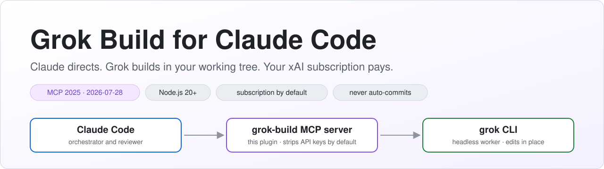
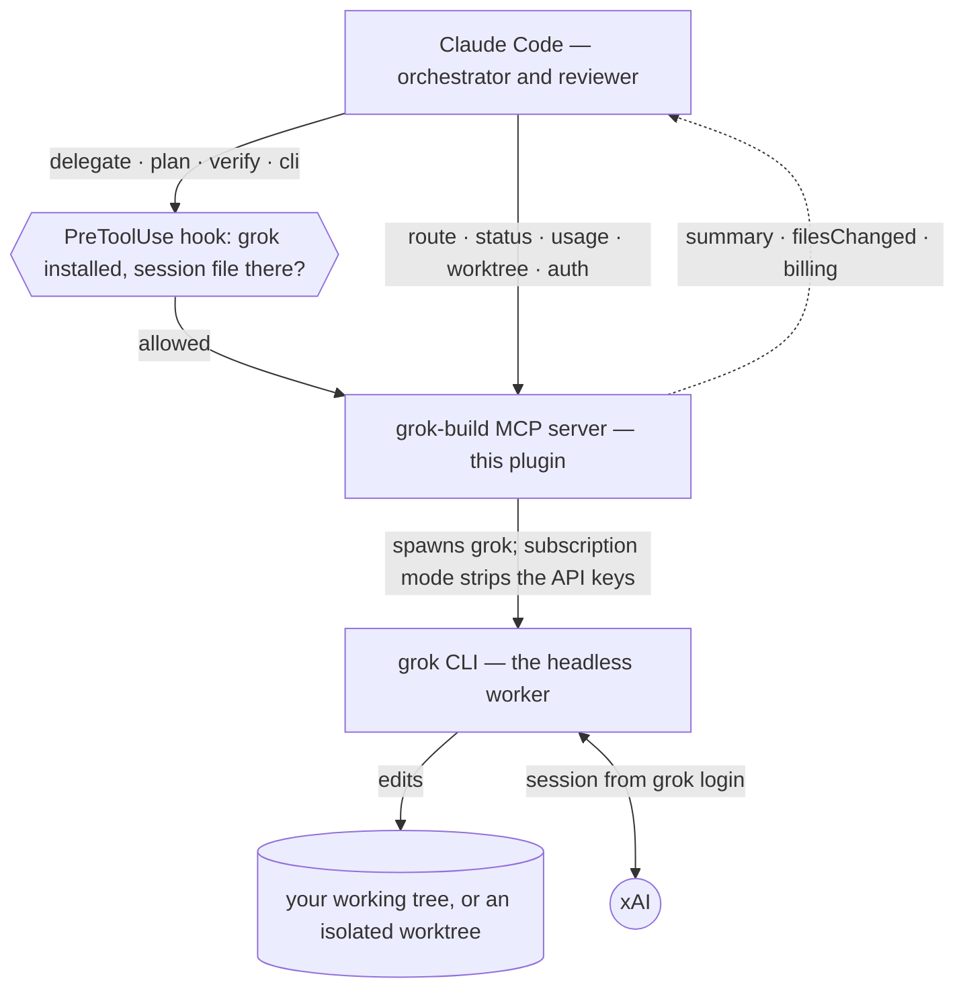
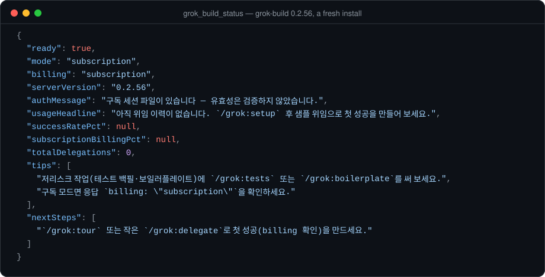
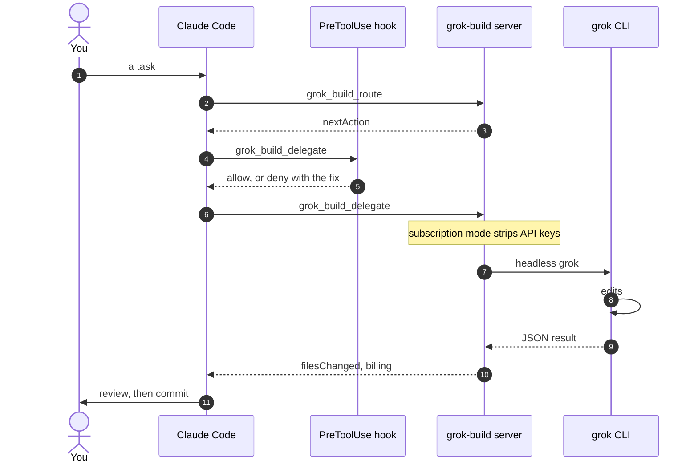

<h1 align="center">
  <picture>
    <source media="(prefers-color-scheme: dark)" srcset="docs/images/hero-dark.svg">
    
  </picture>
</h1>

<p align="center">
  <b>English</b> · <a href="README.ko.md">한국어</a>
</p>

<p align="center">
  <a href="https://github.com/xzawed/claude-grok-build-plugin/actions/workflows/ci.yml"></a>
  <a href="LICENSE"></a>
  
  
  
</p>

> A **Claude Code plugin** that lets Claude hand coding work to the
> **[Grok Build](https://x.ai/cli)** CLI — billed to your **xAI subscription**, not silently to a
> metered API.
>
> Claude directs, Grok executes in your working tree, and you keep the quality gate: nothing is
> committed for you.

**Goals:** use Grok well · see where Grok is strong · Claude ↔ Grok collaboration —
[`docs/00-product-vision.md`](docs/00-product-vision.md). Reading as a human? Start at
[`docs/08-getting-started-with-grok.md`](docs/08-getting-started-with-grok.md). After install, run
**`/grok:tour`** — a 15-minute guided first win, billing check included.

**Contents:** [What it does](#what-it-does) · [Quick start](#quick-start) · [When to delegate](#when-to-delegate--and-when-not) ·
[Commands](#commands) · [MCP tools](#mcp-tools) · [How a delegation runs](#how-a-delegation-runs) ·
[Billing and approval safety](#billing-and-approval-safety) · [Protocol support](#protocol-support) ·
[Verify install and billing](#verify-install-and-billing) · [Troubleshooting](#troubleshooting) · [Docs](#docs)

## What it does



- **When to delegate, not just how.** Claude-side routing — `/grok:route` and the `grok-routing`
  skill — proposes Grok for bulk, low-risk work and keeps architecture and security in Claude.
- **Isolation for volume work.** A delegation can run in a dedicated git worktree, so a
  migration, test backfill, or boilerplate pass touches nothing in your checkout until you apply
  it. Grok Build also spawns subagents of its own during a run.
- **Subscription, not metering.** By default the server strips `XAI_API_KEY` /
  `GROK_CODE_XAI_API_KEY` before it spawns `grok`, so delegated work runs inside your SuperGrok /
  X Premium+ plan instead of at metered API rates.
- **Conventions carry over.** Grok Build reads your existing `CLAUDE.md` / `AGENTS.md` and
  `.claude/` config (skills, agents, MCP, hooks) with no extra setup.

The MCP server and its hook ship prebuilt in `mcp-server/dist/`, so installing the plugin needs no
build step.

## Quick start

### Requirements

| Requirement | What it takes | Check |
|---|---|---|
| Claude Code | A release with plugin support — measured with 2.1.332 | `claude --version` |
| Grok Build CLI | `grok` on your PATH — measured with 1.0.92 (it updates itself) | `grok --version` |
| Node.js | **20 or newer**, as the `node` on your PATH — the plugin's MCP server runs on it | `node --version` |
| xAI plan | An active **SuperGrok / X Premium+** subscription — or an xAI API key for [metered API mode](#auth-modes) | The step 2 smoke test |

> [!NOTE]
> On Node 18 the MCP server prints one line naming the version it found and does not start; an older Node may stop on
> a syntax error before it can (Node 16.0 does). Either way the grok tools do not appear.

Steps 1–2 run once in your terminal, and only the install command differs per OS. Step 3 runs
inside Claude Code and is identical everywhere.

### 1. Install the Grok Build CLI (one-time)

- **macOS / Linux** — any shell (bash, zsh):
  ```bash
  curl -fsSL https://x.ai/cli/install.sh | bash
  ```
- **Windows — PowerShell** (e.g. a Windows Terminal tab):
  ```powershell
  irm https://x.ai/cli/install.ps1 | iex
  ```
- **Windows — WSL** (Ubuntu, etc.): run the macOS/Linux command *inside* your WSL shell.

> [!IMPORTANT]
> Windows Command Prompt (`cmd.exe`) is not supported by either installer — use PowerShell or
> WSL. Pick one side and run Claude Code on it too: a WSL install is invisible to native Windows,
> and vice versa.

### 2. Log in and smoke-test (browser OAuth, one-time)

```bash
grok login
grok --no-auto-update -p "Say ok."
```

The plugin never logs in for you and never stores a key.

### 3. Install the plugin — inside Claude Code

These are **Claude Code prompts, not terminal commands**, and are identical on every OS:

```
/plugin marketplace add xzawed/claude-grok-build-plugin
/plugin install grok@grok-marketplace
/reload-plugins
/grok:setup
```

`/grok:setup` confirms you're ready. Then **`/grok:tour`** walks auth → route demo → tiny sample
→ what to try next.

### What a fresh install shows

`/grok:status` reads the `grok_build_status` tool. This is that tool's real, unedited result from the v0.2.56 bundle,
in a fresh home whose session file is an empty placeholder (`{}`) and that has no delegation history: `ready`, the
`mode` and the `billing` it implies, the `serverVersion` you are running, and what to try first. The tool checks only
that the session file exists, never its contents, so a real `grok login` shows the same — `ready: true` means the file
is there, not that the session works. The server's own messages are in Korean.
[`mcp-server/scripts/status-figure.mjs`](mcp-server/scripts/status-figure.mjs) draws the figure, and a test compares it
with what the current bundle answers.

<p align="center">
  
</p>

### Updating

Installing is one-time; updating is three steps, and **the order matters**. The first two are
terminal commands, not Claude Code prompts:

```bash
claude plugin marketplace update grok-marketplace   # 1. refresh the local marketplace clone
claude plugin update grok@grok-marketplace          # 2. install the new version
```

Then **restart Claude Code** and re-check `/grok:status` — `serverVersion` should be the new one.

Step 1 is not optional. `/plugin marketplace add` leaves a local clone registered with
`autoUpdate: false`, so while that clone is stale, step 2 sees no new version to install (measured
2026-09-04). And `claude plugin update` only applies on restart: until you restart, the session
keeps the MCP server process it started with.

> [!NOTE]
> `/grok:update` is a different command — it updates the **grok CLI**, not this plugin.

## When to delegate — and when not

| Hand to Grok | Keep in Claude |
|---|---|
| Bulk, repetitive edits — one pattern across many files, renames, import fixes | Architecture and design decisions |
| Low-risk volume — test backfill, docs sync, boilerplate | Security and compliance — auth, permissions, crypto, regulated domains |
| Narrow, independent scope — one module, clear acceptance criteria | Anything needing whole-monorepo context |
| Exploratory prototypes you were going to review anyway | The final review and quality gate |

`/grok:route` applies this for you and returns a `nextAction` — it never executes anything and
never bills. Full criteria: [`docs/05-routing-policy.md`](docs/05-routing-policy.md).

## Commands

The plugin ships 27 `/grok:*` commands — Claude Code derives the prefix from the plugin name,
`grok`. The 15 below are the ones you type day to day; the other 12 wrap grok's own CLI and are
collapsed under the tables.

**Everyday loop**

| Command | What it does |
|---|---|
| `/grok:route` | Recommend Claude vs Grok + **`nextAction`** (no execution, no billing) |
| `/grok:plan "<task>"` | Plan preview — reads files; the shell, edits and MCP tools are denied, even ones your own allow rules approve. grok enforces that, so still check `planWroteFiles` |
| `/grok:delegate "<task>"` | Delegate a task; grok edits in `cwd`, no auto-commit |
| `/grok:verify "<task>"` | Delegate + grok self-verification (prompt checklist) |
| `/grok:review` | Post-edit quality gate (diff + billing; never auto-commit) |
| `/grok:worktree` | List / diff / apply / remove / prune isolation worktrees (no auto-commit) |
| `/grok:resume` | Continue a prior Grok session (`lastSession.sessionId`) |
| `/grok:usage` | Usage summary + insights (success rate, subscription share) |

**Setup, presets, passthrough**

| Command | What it does |
|---|---|
| `/grok:setup` | Verify grok install + login; first-success sample + next scenarios |
| `/grok:status` | **Dashboard** — ready?, billing, usage, last session, next steps |
| `/grok:tour` | **15-minute guided tour** — auth, route demo, tiny first win, next recipes |
| `/grok:tests` | Preset: test backfill / expansion |
| `/grok:migrate` | Preset: mechanical multi-file migration |
| `/grok:boilerplate` | Preset: scaffold / boilerplate |
| `/grok:cli "<raw grok args>"` | Passthrough: any grok subcommand under the billing-safe env |

<details>
<summary><b>The other 12 — grok's own CLI verbs</b></summary>

| Command | What it does |
|---|---|
| `/grok:sessions` | List, search, or delete Grok sessions (no restore — use `/grok:resume`) |
| `/grok:export` | Export a Grok session transcript as Markdown |
| `/grok:memory` | Manage Grok cross-session memory |
| `/grok:inspect` | Show the configuration Grok discovers for this directory |
| `/grok:models` | List available Grok models |
| `/grok:mcp` | Manage Grok's MCP server configurations |
| `/grok:login` | Guide the one-time terminal login (never runs it for you) |
| `/grok:logout` | Sign out and clear cached credentials |
| `/grok:update` | Check for or install Grok updates |
| `/grok:version` | Show the installed Grok version |
| `/grok:trace` | Export or upload Grok session trace data |
| `/grok:import` | Returns `blocked` — not a Grok CLI 1.0 subcommand; use `/grok:sessions` + `/grok:resume` |

Two things worth knowing about this group:

- `/grok:worktree` is **not** one of them. It is backed by the `grok_build_worktree` tool, a
  different tracker from grok's own `worktree` subcommand.
- `/grok:login` and `/grok:import` never spawn grok: the first hands you the terminal command,
  the second reports `blocked`. The same guard covers grok's non-headless and account-level modes
  (`dashboard`, `agent`, `leader`, `completions`, `wrap`, `worker`/`cursor-worker`, `workspace`),
  which the wrapper refuses rather than let them hang a headless call or act on your account.
</details>

**Skills and agent (auto-discovered):**

- `grok-routing` — propose Grok on bulk/low-risk work; keep architecture/security in Claude
- `grok-first-mile` — onboarding / "what do I try first?"
- `grok-worker` agent — execute volume work via MCP tools, Claude reviews

## MCP tools

The commands drive nine MCP tools that `mcp-server/` (TypeScript, ESM) serves over stdio, plus a PreToolUse
auth-check hook. Four of them run the grok CLI; the hook gates those four. Request and response schemas:
[`docs/04-mcp-server-spec.md`](docs/04-mcp-server-spec.md).

| Tool | What it does | Runs grok |
|---|---|---|
| `grok_auth_check` | Is grok installed, and is the session file (or the API key) there? It checks presence, never contents | No |
| `grok_build_status` | The dashboard `/grok:status` reads: auth, `mode` and `billing`, usage, last session, next steps, and any `billingCaveat` | No |
| `grok_build_route` | Recommend Claude vs Grok for a task and return a `nextAction` | No |
| `grok_build_delegate` | Hand a task to grok, in `cwd` or an isolated git worktree; reports `filesChanged`, `billing`, `committed` | Yes |
| `grok_build_plan` | Plan preview: the shell, edits, writes and MCP tools are denied to grok, and `planWroteFiles` says whether it wrote anyway | Yes |
| `grok_build_verify` | Delegate with a self-verification checklist in the prompt | Yes |
| `grok_build_usage` | Delegation history from `~/.grok-build/history.jsonl`, with success rate and subscription share | No |
| `grok_build_worktree` | List the repository's worktrees; diff, apply, remove or prune the wrapper's own isolation worktrees. It never commits | No |
| `grok_cli` | Any grok subcommand under the billing-safe env; refuses the ones that cannot run headless or act on your account | Yes |

## How a delegation runs



Routing (step 2, `grok_build_route`) neither runs nor bills. The hook (4–5) denies the call when grok is not installed
and, in subscription mode, when there is no session file — naming the fix — and otherwise lets it through; it checks
that the file exists, not that the session works, and a `grok_cli` call needs the session only when it can run a turn.
In subscription mode the server strips `XAI_API_KEY` and `GROK_CODE_XAI_API_KEY`, then runs grok headless (7) with
`--no-auto-update`, `--always-approve`, `--cwd <folder>`, the prompt as `--single=<prompt>` (`--prompt-file` when it is
too long for the command line) and `--output-format json`; a plan run passes `--permission-mode plan` and its deny
rules instead of `--always-approve`. grok edits in `cwd` or in a git worktree (8). For a delegation the server hands
Claude a structured summary — `status`, `filesChanged`, `billing`, `committed` — not grok's raw output (10), and you
review the diff with `/grok:review` and commit yourself (11). Full architecture:
[`docs/01-architecture.md`](docs/01-architecture.md).

## Billing and approval safety

> [!CAUTION]
> In **subscription mode — the default —** the server strips `XAI_API_KEY` and
> `GROK_CODE_XAI_API_KEY` before spawning `grok`, so neither of those two variables can be the
> credential a delegation runs on. (A model in grok's own `config.toml` can still carry a key of
> its own, through `api_key` or an `env_key` naming any other variable, or inherit one from a
> `[model_providers.<id>]` table through `model_provider`. The strip cannot reach that key,
> so the plugin reports it as `billingCaveat` instead — see Troubleshooting.) That is a guarantee
> about what the process is *handed*,
> not a claim about which credential the CLI would have picked: measured on grok 1.0.13, a live
> session token wins and the env key is not attempted. It becomes the fallback the moment the
> session is missing or expired — which is exactly when a run that began as "subscription" could
> quietly bill metered instead. Stripping it makes that run fail loudly rather than silently
> switch who pays. See [`docs/specs/grok-cli-contract.md`](docs/specs/grok-cli-contract.md) §10.

- Every `grok_build_delegate` response reports the `mode` it was configured with and the `billing`
  that mode implies — a tag derived from `GROK_BUILD_AUTH_MODE`, not an observation of what xAI
  actually charged (`docs/specs/grok-cli-contract.md` §2).
- The server never stores or logs your credentials. It checks that your session file or key is
  present without reading it. It reads grok's `config.toml` only to note which models carry a
  key of their own or inherit one from `[model_providers.<id>]`, and drops the key text on the
  spot (`billingCaveat`).
- **Delegations are logged locally.** Each one appends a line to `~/.grok-build/history.jsonl`
  containing the first ~200 characters of your prompt, the working directory, and which files
  changed. `/grok:usage` and `/grok:status` read it back, so those previews re-enter a later
  Claude session. Known secret shapes are redacted before writing — but pattern matching is
  mitigation, not a guarantee, so treat a prompt like anything else you would not paste into a
  log. Delete the file to clear it; nothing else depends on it.

> [!WARNING]
> **Every delegation auto-approves all of grok's tool use** — shell commands, deletions,
> installs, network, git — not just file edits, and non-file side effects never show up in the
> `filesChanged` diff. Headless `grok` cannot be relied on to edit without `--always-approve`
> (without it, a call that neither your allow rules nor grok's `[ui] permission_mode` approves is
> cancelled — `stopReason: "cancelled"`), so the plugin always passes it.
>
> `grok` edits directly in the target `cwd`; the plugin **never commits** (it tells grok not to,
> and reports `committed` if grok does) — you review first.
> For riskier work, isolate the run through the tool’s own fields, not grok flags:
> `worktree: true` (the wrapper makes a real `git worktree`; grok’s own `--worktree` is a
> no-op under headless `-p` and the wrapper never passes it) and
> `sandbox: "workspace" | "strict" | …`. Both are reachable from `/grok:delegate`.
> Kernel enforcement of `sandbox` is Linux/macOS only.

Full rationale and verification checklist: [`docs/02-auth-strategy.md`](docs/02-auth-strategy.md).

### Auth modes

Chosen **once, at the server level**, via `GROK_BUILD_AUTH_MODE` — there is no per-call override.

| | `subscription` (default) | `api` (opt-in) |
|---|---|---|
| Trigger | unset, or `=subscription` | `GROK_BUILD_AUTH_MODE=api` |
| Env handling | API keys **stripped** before spawn | keys **passed through** |
| Auth source | `~/.grok/auth.json` (`grok login`) | the API key in your environment |
| Billing | xAI subscription (flat) | metered API |
| Response `billing` | `"subscription"` | `"metered_api"` |

If you never set `GROK_BUILD_AUTH_MODE`, every delegation runs in subscription mode.

<details>
<summary><b>API mode setup (opt-in, metered)</b></summary>

The mode is read from `GROK_BUILD_AUTH_MODE` in the environment that launches the MCP server.
Two equivalent ways:

- **Process env (recommended)** — set it where Claude Code starts, so a plugin update can't
  overwrite it:
  ```bash
  export XAI_API_KEY="..."          # your own key; the plugin never issues or stores one
  export GROK_BUILD_AUTH_MODE=api
  ```
- **`.mcp.json` env block** — add an `env` to the `grok-build` entry (may be overwritten on a
  plugin update):
  ```json
  "grok-build": {
    "command": "node",
    "args": ["${CLAUDE_PLUGIN_ROOT}/mcp-server/dist/index.js"],
    "env": { "GROK_BUILD_AUTH_MODE": "api" }
  }
  ```
</details>

## Protocol support

The server answers either MCP protocol era on stdio; each connection's opening exchange picks one. Both eras serve the
same nine tools, input schemas, result shapes and capabilities. What differs from the SDK v1 bundles (v0.2.55 and older) is
in [`docs/04-mcp-server-spec.md`](docs/04-mcp-server-spec.md), "두 프로토콜 계열".

| Protocol era | How a session opens | Revisions served | Who connects this way |
|---|---|---|---|
| 2025 | `initialize`, then `notifications/initialized` | `2025-11-25` · `2025-06-18` · `2025-03-26` · `2024-11-05` · `2024-10-07` | Clients built on the 2025 specification |
| 2026-07-28 | `server/discover`; every request then carries `params._meta` | `2026-07-28` | Claude Code 2.1.332 (measured: it connects to this plugin in this era) |

The SDK that serves the 2026-07-28 era (MCP SDK v2) needs Node.js 20, which is why the floor moved there in v0.2.56.

## Verify install and billing

From inside Claude Code, after install + a one-time `grok login`:

1. **`/grok:status`** (or `/grok:setup`) → `ready`, `mode`, expected `billing`, `serverVersion`.
2. **`/grok:delegate "create a file hello.txt containing exactly: ok"`** in a throwaway directory
   — grok edits there for real → confirm `filesChanged` lists `hello.txt`, then check the field
   that matters: **`billing: "subscription"`**, not `metered_api`.
   - Nothing was committed. Review the diff with **`/grok:review`**.
3. **`/grok:plan "add input validation to the main function"`** → a plan summary; check that
   `planWroteFiles` is `false` (a plan run is not guaranteed read-only).
4. **`/grok:route`** → a `nextAction` recommendation; **`/grok:usage`** → history plus the
   `lastSession` that **`/grok:resume`** continues.

## Troubleshooting

| Symptom | What it means | Fix |
|---|---|---|
| The grok tools don't appear in Claude Code, so `/grok:setup` cannot call them | The plugin's MCP server did not start. Usually the `node` on your PATH is older than Node.js 20. Otherwise `GROK_BUILD_AUTH_MODE` is neither `subscription` nor `api`, and the server stopped with one line naming the value | Run `node --version` and update Node.js — or fix or unset the variable — then restart Claude Code |
| `/grok:setup` isn't found after `/reload-plugins` | The `/grok:*` invocation strings and the marketplace schema aren't frozen across Claude Code versions | Run `/help` for the exact form, then see [`docs/03-plugin-spec.md`](docs/03-plugin-spec.md) |
| `/grok:delegate` is blocked before it runs, telling you to run `grok login` | You aren't logged in. The PreToolUse hook and the server's own auth check both gate this; under the default (unset) mode the hook stops you first | Run `grok login` in your terminal, then retry |
| `/grok:status` shows a **`grokHomeNote`** about a relative `GROK_HOME`, or a delegation still says to log in after you did | `GROK_HOME` is a relative path (or, on Windows, one like `\grok` that starts at the drive root with no drive letter). grok resolves it against the folder it runs in — the task folder, or a brand-new worktree with `worktree: true` — and does not expand `~` (measured on Windows). So each folder has its own grok home, and a `grok login` run from another folder may have landed in another one | Set `GROK_HOME` to an absolute path — on Windows one that starts with the drive letter, like `C:\…` (grok puts a drive-less `\grok` on the drive of the folder it runs in) — and restart Claude Code. If per-folder homes are what you want, run `grok login` from the task folder. With `worktree: true`, a home inside the new worktree never has a session — use an absolute `GROK_HOME` for worktree runs |
| **`grokHomeNote`** says `GROK_HOME` has whitespace at the start or end | A space, tab or line break is part of the value. A classic source is cmd: `set GROK_HOME=C:\x && claude` puts the space before `&&` into it. grok keeps the whitespace as part of the path: with a trailing space it looks for its session in a folder whose name ends in that space — not the one you signed in to; with a trailing tab or line break, or a space in front of a drive letter, the path is invalid and grok fails outright | Remove the whitespace — in cmd, `set "GROK_HOME=C:\x"` — and restart Claude Code, before running `grok login` again |
| A delegation ends with **`paymentRequired: true`** and an HTTP 402 message | xAI refused the turn for payment. On a subscription with xAI's words "Grok Build usage balance exhausted", your Grok Build usage is used up. Nothing went metered: subscription mode never hands grok an API key from the environment | Wait until the usage is back — retrying sends the same request and gets the same answer. In `api` mode, check the usage and billing of the credential the request used |
| `/grok:status` reports **`billingMismatch`** | The server is in subscription mode, but past delegations were recorded as metered. Those ran under `api` mode — it is never evidence of a leaked key, since subscription mode strips them | Sort the billing path out — check `GROK_BUILD_AUTH_MODE` — before delegating again |
| `/grok:status` or a delegation reports **`billingCaveat`** | With `reason: "config_model_keys"`, grok's own `config.toml` (under `GROK_HOME`, default `~/.grok`) gives the listed models their own key, through `api_key` or an `env_key` whose variable is set — or a key they inherit through `model_provider` from a `[model_providers."…"]` table, which the `message` names. grok uses that key before your subscription session, so runs on those models may bill that key even though `billing` says `subscription`. Nothing is blocked. With `reason: "config_unreadable"`, the file could not be checked | If you didn't mean it, remove `api_key` / `env_key` from that `[model."…"]` table, or unset the variable and restart Claude Code (the server checks the environment it started with). For an inherited key, remove the model's `model_provider` line. If you did, you can ignore it. For `config_unreadable`: make it a readable regular file under 1 MiB, in valid TOML — grok itself refuses to start on a parse error |
| `serverVersion` still shows the old version after a plugin update | The MCP server process predates the update | Restart Claude Code, then re-check `/grok:status`. Still old? The marketplace clone was stale — see [Updating](#updating) |
| Every `/grok:*` tool refuses with `reason: "inside_grok_worker"` | The server believes it runs **inside a Grok worker** this plugin started, which it learns from `GROK_BUILD_WORKER=1`. grok loads installed Claude plugins into its workers, so the plugin's own server runs there too, and it refuses so a worker can't start another Grok run through the plugin. In a Grok transcript this is expected | Only if you see it in your own Claude Code session: that session inherited `GROK_BUILD_WORKER=1` — typically from an editor or terminal multiplexer a Grok worker launched first. Start Claude Code from a clean shell |

## Docs

| Doc | What it covers |
|---|---|
| [`00-product-vision.md`](docs/00-product-vision.md) | Why this exists — use Grok well · feel Grok · Claude ↔ Grok collaboration |
| [`08-getting-started-with-grok.md`](docs/08-getting-started-with-grok.md) | **Start here as a human** — the 15-minute path and recipes |
| [`01-architecture.md`](docs/01-architecture.md) | The big picture |
| [`02-auth-strategy.md`](docs/02-auth-strategy.md) | The two-track auth constraint (the most important doc) |
| [`03-plugin-spec.md`](docs/03-plugin-spec.md) · [`04-mcp-server-spec.md`](docs/04-mcp-server-spec.md) | What makes up the plugin and `mcp-server/`, including the two protocol eras |
| [`05-routing-policy.md`](docs/05-routing-policy.md) | When to delegate |
| [`06-roadmap.md`](docs/06-roadmap.md) | Implementation order and current status |
| [`07-orchestrator-integration.md`](docs/07-orchestrator-integration.md) · [example](examples/orchestrator-consumer.md) | The Task Manager ↔ route/`nextAction` contract |
| [`09-scope-and-residuals.md`](docs/09-scope-and-residuals.md) | What's finished in this repo, what deliberately lives outside it, and each release's acceptance record |
| [`10-service-audit-queue.md`](docs/10-service-audit-queue.md) | The open-defect queue and how defects are reproduced |
| [`11-maintainer-playbook.md`](docs/11-maintainer-playbook.md) | How a defect is fixed and verified here, and the detail moved out of `CLAUDE.md` (a trap added since points at its own source or test instead) |
| [`specs/grok-cli-contract.md`](docs/specs/grok-cli-contract.md) | The `grok` CLI flags and output schema this plugin was built against, each one measured |
| [`releases/`](docs/releases) · [`CHANGELOG.md`](CHANGELOG.md) | What each version shipped and how it was measured · the history index |

<details>
<summary><b>Folder structure</b></summary>

```
claude-grok-build-plugin/
├── README.md · README.ko.md   # this file (EN / KO)
├── CLAUDE.md                  # project context auto-loaded by Claude Code
├── CHANGELOG.md               # history index (one line per entry)
├── CONTRIBUTING.md            # branch/PR rules, dist + version rules
├── LICENSE                    # MIT
├── docs/                      # design specs, kept in sync with the code
│   ├── 00-product-vision.md … 11-maintainer-playbook.md
│   ├── specs/                 # dated design/verification specs (e.g. grok-cli-contract.md)
│   ├── plans/ · releases/     # implementation plans, per-version release notes
│   ├── images/                # README figures (the banner, a real grok_build_status result)
│   └── history/               # CHANGELOG entries moved out in full: 2026-10-09 (one file per work date), 2026-11-28 (2026-10-09 ~ 2026-10-29, one file)
├── examples/                  # orchestrator consumer kit
├── .claude-plugin/plugin.json        # plugin manifest (name: grok)
├── .claude-plugin/marketplace.json   # marketplace entry (grok-marketplace)
├── .mcp.json                         # MCP server registration
├── mcp-server/                       # TS MCP server + hook (ships prebuilt dist/index.js + dist/hook.js + dist/THIRD_PARTY_NOTICES.md)
├── commands/                         # /grok:* (+ tour, presets)
├── skills/                           # grok-routing, grok-first-mile
├── agents/grok-worker.md             # volume-work subagent
├── hooks/                            # pre-delegate-auth-check PreToolUse hook
└── .github/workflows/                # CI (ubuntu + windows, and a Node 20 job)
```

**In-repo scope is complete.** External Task Manager wiring lives in consumer repos; Claude Code
GUI clicks are a manual release checklist; ACP is deferred.

See [`docs/09-scope-and-residuals.md`](docs/09-scope-and-residuals.md) and
[`docs/06-roadmap.md`](docs/06-roadmap.md).
</details>

## License

[MIT](LICENSE) © 2026 xzawed. The bundles in `mcp-server/dist/` carry third-party code — the MCP SDK, zod, and the
packages vendored inside the SDK — and their license texts travel with them in
[`mcp-server/dist/THIRD_PARTY_NOTICES.md`](mcp-server/dist/THIRD_PARTY_NOTICES.md).
